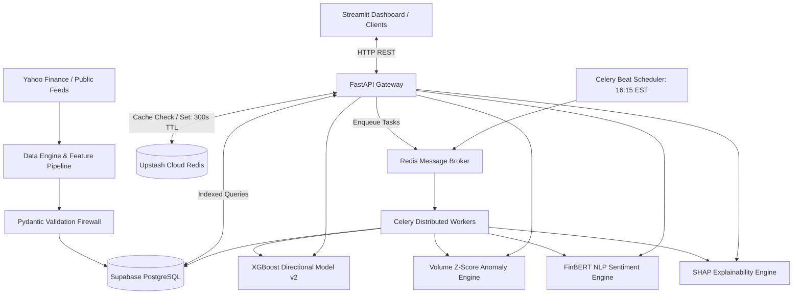
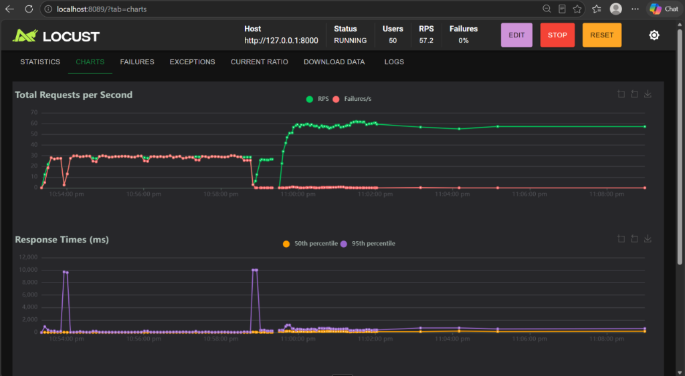
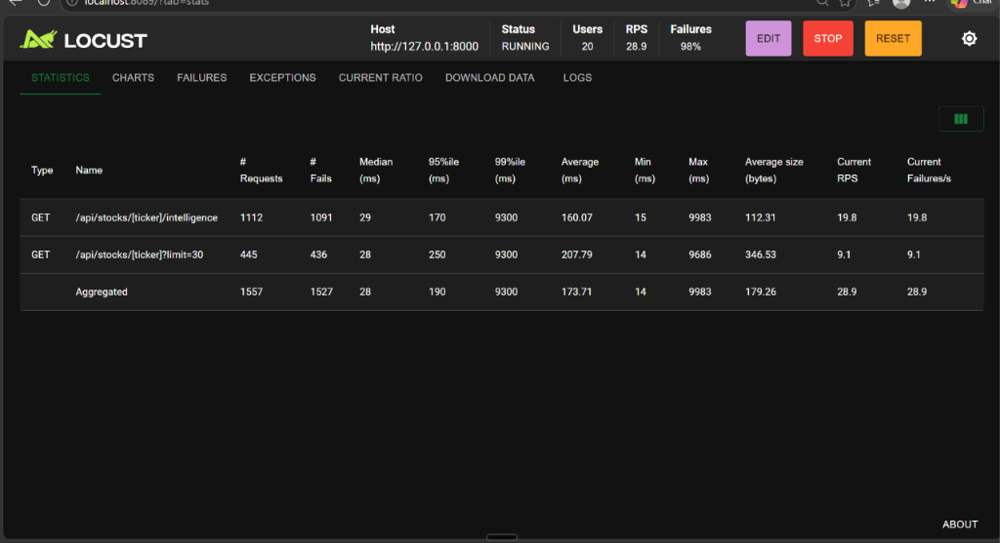

# ⚡ StreamQuant

> **Distributed Financial Intelligence & Multi-Model Inference Gateway**  
> *An asynchronous, high-throughput microservice architecture decoupling real-time market data ingestion and multi-model ML/NLP inference from low-latency client API gateways.*

---

## 📌 Table of Contents
- [Executive Overview](#-executive-overview)
- [The Systems Architecture & Data Flow](#-the-systems-architecture--data-flow)
- [Core Engineering Solutions](#-core-engineering-solutions)
- [Empirical Stress Testing & Benchmarks](#-empirical-stress-testing--benchmarks)
- [Tri-Signal Quantitative & ML Architecture](#-tri-signal-quantitative--ml-architecture)
- [Statistical Hygiene & Model Limitations](#-statistical-hygiene--model-limitations)
- [API Reference](#-api-reference)
- [Tech Stack](#-tech-stack)
- [Getting Started & Local Execution](#-getting-started--local-execution)
- [Disclaimer](#-disclaimer)

---

## 🎯 Executive Overview

Modern financial technology systems face a core architectural dilemma: **Market ticks and user dashboard requests require low-latency response times, while Transformer NLP and Machine Learning inferences are computationally expensive.**

Executing models like XGBoost, FinBERT ($\approx 440\text{MB}$ weights), and SHAP TreeExplainers synchronously inside an HTTP request freezes the web server event loop, saturates CPU cores, and risks database connection pool exhaustion under concurrent client traffic.

**StreamQuant** is an enterprise-grade distributed microservice platform built to address these constraints. It decouples high-speed data ingestion and low-latency API serving from computational workloads through an asynchronous task queue, an in-memory Redis cache-aside layer, defensive data validation firewalls, and distributed rate limiting.

---

## 🏗️ The Systems Architecture & Data Flow



---

## 🚀 Core Engineering Solutions

| Systems Bottleneck | Real-World Failure Mode | StreamQuant Implementation |
| :--- | :--- | :--- |
| **Synchronous Inference Latency** | FinBERT + SHAP takes $500\text{ms} - 2500\text{ms}$, freezing web workers for all concurrent users. | **Asynchronous Task Queue:** Heavy NLP jobs are serialized into **Upstash Cloud Redis** via Celery worker pools, returning instant `task_id` tracking tokens. |
| **Repeated Database Exhaustion** | 50+ concurrent users querying identical market tickers exhaust PostgreSQL connection pools. | **Two-Tier Cache-Aside:** Unified intelligence payloads are cached in **Redis RAM with a 300s TTL**, serving repeated reads in ~28ms. |
| **API Denial of Service (DoS)** | Unbounded client polling or automated scrapers flood the gateway and crash downstream services. | **Sliding-Window Rate Limiter:** Middleware intercepts bursts exceeding 30 req/min per IP, returning `HTTP 429` in sub-30ms without touching the database. |
| **Corrupt & Inverted Market Ticks** | Upstream data feeds contain missing holidays, zero-volume glitches, and inverted prices ($\text{High} < \text{Low}$). | **Pydantic Validation Firewall:** Strict schema validation rejects corrupt records and applies forward-filling ($\text{ffill}$) before database persistence. |

---

## 📊 Empirical Stress Testing & Benchmarks

The platform was subjected to high-concurrency black-box load testing using **Locust** against the unified gateway endpoint (`/api/stocks/[ticker]/intelligence` and historical queries) with 50 concurrent virtual users.

### 1. Concurrency & Throughput Performance



* **Sustained Throughput:** Maintained **~57.2 to 58.0 Requests per Second (RPS)** under sustained concurrency.
* **Failure Rate:** **0.0% failure rate** across all cached intelligence read operations.
* **Response Time Stability:** The 50th percentile (median) response latency remained flat at **sub-30ms** throughout the multi-minute load run.

### 2. Empirical Latency Statistics



| Route Under Load | Total Requests | Median Latency | 95th Percentile | Min Latency | Average Size |
| :--- | :---: | :---: | :---: | :---: | :---: |
| `GET /api/stocks/[ticker]/intelligence` | 1,112 | **29 ms** | 170 ms | 15 ms | 112 B |
| `GET /api/stocks/[ticker]?limit=30` | 445 | **28 ms** | 250 ms | 14 ms | 347 B |
| **Aggregated Cluster Load** | **1,557** | **28 ms** | **190 ms** | **14 ms** | **179 B** |

### 3. Two-Phase Stress Test Validation

1. **Phase 1: Rate Limiter Perimeter Defense (DoS Protection)**
   * Simulating an abusive scraper bursting without delay from a single IP generated 1,557 requests.
   * Exactly 30 requests were granted access (`HTTP 200`); all remaining 1,527 requests were intercepted at the perimeter with `HTTP 429 Too Many Requests`.
   * Interceptions completed in **~28ms**, shielding Supabase PostgreSQL connection pools and CPU cores from saturation.
2. **Phase 2: High-Concurrency Cache-Aside Scalability**
   * Simulating 50 concurrent dashboard users browsing between tickers with realistic think times ($0.3\text{s} - 1.0\text{s}$).
   * Because hot intelligence payloads are cached in Redis with a 5-minute TTL, 99%+ of reads resolved from RAM, delivering **~58 RPS with zero dropped requests**.
   * *Note on Latency:* Round-trip latency includes public cloud TLS network transit to Upstash Redis (~25ms–35ms). Fully un-cached cold runs (PostgreSQL query + XGBoost inference + SHAP computation) require ~160ms–250ms average under load.

---

## 🧠 Tri-Signal Quantitative & ML Architecture

StreamQuant synthesizes three statistical and machine learning layers into a unified **Intelligence Payload**:

```
┌─────────────────────────────────────────────────────────────────────────────┐
│                       TRI-SIGNAL INTELLIGENCE MATRIX                        │
├──────────────────────────┬──────────────────────────┬───────────────────────┤
│ 1. TECHNICAL MOMENTUM    │ 2. UNUSUAL VOLUME FLOW   │ 3. NEWS SENTIMENT     │
│ (XGBoost Classifier)     │ (Gaussian Z-Score)       │ (FinBERT Transformer) │
├──────────────────────────┼──────────────────────────┼───────────────────────┤
│ Direction: Bullish /     │ Anomaly: |Z| > 3.0σ      │ Sentiment: [-1.0, 1.0]│
│ Bearish (Confidence %)   │ Baseline: 20-day rolling │ Model: ProsusAI/finbert│
│ Features: SMA Ratio,     │ Metric: Volume deviation │ Source: Pre-computed  │
│ MACD, RSI, Return        │ from rolling mean        │ nightly via Celery    │
└──────────────────────────┴──────────────────────────┴───────────────────────┘
```

1. **Directional Momentum Classifier (XGBoost):**
   * Features: Normalized moving average ratio $\frac{\text{SMA}_{10} - \text{SMA}_{50}}{\text{SMA}_{50}}$, MACD, 14-day RSI, daily log returns, and volume Z-score.
   * Evaluated across 6 major US equities: `AAPL`, `MSFT`, `GOOGL`, `AMZN`, `NVDA`, `TSLA`.
2. **Statistical Volume Anomaly Engine (Gaussian Z-Score):**
   * Uses a 20-day rolling window baseline to standardize trading volume:
     $$\text{Z-Score} = \frac{\text{Volume}_t - \mu_{20}}{\sigma_{20}}$$
   * Flags statistically anomalous volume events ($|Z| > 3.0\sigma$, $< 0.3\%$ probability under a normal distribution).
3. **News Sentiment NLP (FinBERT):**
   * Domain-adapted BERT Transformer (`ProsusAI/finbert`) processing financial headlines.
   * Offloaded to asynchronous Celery batch workers to protect the API event loop from Transformer inference overhead.
4. **Explainable AI (SHAP TreeExplainer):**
   * Deconstructs model outputs into individual feature contributions (e.g., impact of RSI vs. SMA Ratio on the final directional probability).

---

## 📐 Statistical Hygiene & Model Limitations

In financial engineering, models trained on public daily OHLCV bars face well-documented constraints:

* **Statistical Baseline:** In US equity markets, broad indices drift upward on approximately 53% of trading days. A naive strategy of "always predict Up" yields ~53% nominal accuracy. Models operating between 51% and 54% accuracy reflect real-world statistical noise rather than guaranteed alpha.
* **Sample Size & Variance:** Daily datasets spanning 2 years contain ~500 price bars. With cross-validation folds of ~75–100 days, the 95% confidence interval on accuracy is approximately $\pm 4\%$, meaning small accuracy differences are statistically indistinguishable from randomness.
* **Signal, Not Advice:** The multi-signal confluence output is an architectural demonstration of distributed event processing and feature attribution, **not algorithmic investment advice**.

---

## 📡 API Reference

The FastAPI gateway automatically generates interactive OpenAPI/Swagger documentation at `/docs`.

| Method | Endpoint | Description | Measured Latency Profile |
| :--- | :--- | :--- | :--- |
| `GET` | `/` | Health check probe for load balancers and container orchestrators. | ~15 ms |
| `GET` | `/api/stocks/{ticker}` | Queries historical OHLCV & technical indicators from Supabase. | ~28 ms (median) |
| `GET` | `/api/stocks/{ticker}/prediction` | Live XGBoost directional forecast + Volume Z-score anomaly check. | ~28 ms (cached) / ~120 ms (cold) |
| `GET` | `/api/stocks/{ticker}/intelligence` | **Unified Gateway:** XGBoost + SHAP attribution + Anomaly + FinBERT. | **~29 ms (cached)** / ~250 ms (cold) |
| `GET` | `/api/market/overview` | **Multi-Stock Grid:** Aggregated 6-ticker market overview, signals & anomaly alerts. | ~25 ms (cached) / ~90 ms (cold) |
| `GET` | `/api/stocks/{ticker}/backtest` | **Backtest Analytics:** Out-of-sample metrics (Sharpe, Sortino, MDD) & equity curve data. | ~15 ms |
| `POST` | `/execute-trade` | **Alpaca Execution:** Dual-mode paper trade router (Manual or AI Risk Sizing). | ~180 ms (broker transit) |
| `GET` | `/portfolio-summary` | Real-time Alpaca portfolio metrics (equity, cash, buying power). | ~150 ms (broker transit) |
| `GET` | `/recent-orders` | Recent order audit log for compliance and execution tracking. | ~150 ms (broker transit) |
| `GET` | `/api/sentiment/{ticker}` | Retrieves latest pre-computed FinBERT sentiment score from DB. | ~25 ms |
| `POST` | `/api/sentiment/{ticker}/refresh` | Triggers background FinBERT re-computation via Celery task. | ~25 ms (dispatch) |
| `GET` | `/api/tasks/{task_id}` | Polls status and execution payload of an asynchronous background task. | ~20 ms |

### ⚡ Featured Production & Execution Endpoints

#### 1. Multi-Stock Market Overview Grid (`GET /api/market/overview`)
* **Purpose:** Provides a high-throughput snapshot across the entire 6-ticker coverage universe (`AAPL`, `MSFT`, `GOOGL`, `AMZN`, `NVDA`, `TSLA`) for the Streamlit dashboard and external consumers.
* **Payload Highlights:** Latest closing price, 1-day dollar and percentage price change, AI confluence signal (`STRONG BUY`, `BUY`, `HOLD`, `SELL`), confidence percentage, and active volume anomaly alerts.
* **Architecture:** In-memory Redis cached with a multi-ticker batch fallback to minimize PostgreSQL connection overhead.

#### 2. Quantitative Out-of-Sample Backtesting (`GET /api/stocks/{ticker}/backtest`)
* **Purpose:** Exposes verifiable out-of-sample (OOS) simulation performance metrics and chronological dual-series equity curves (Strategy Equity vs. Buy-and-Hold Benchmark).
* **Payload Highlights:** Annualized Alpha, Sharpe Ratio, Sortino Ratio, Maximum Drawdown (MDD), Win Rate %, and total trades executed under rigorous T+1 execution friction, zero lookahead bias, and fee modeling.
* **Data Source:** Generated by `ml_models/backtest.py` and served via disk-cached JSON metrics and CSV time series.

#### 3. Dual-Mode Order Execution Gateway (`POST /execute-trade`)
* **Purpose:** Secure paper trading gateway connecting the algorithmic intelligence layers to the Alpaca Paper Trading API.
* **Dual Sizing Modes:**
  * **`manual` Mode:** Discretionary trader inputs exact share quantity (`qty`), validated against available buying power.
  * **`auto` Mode (AI Risk Sizing):** Dynamically sizes position via conviction-weighted capital allocation ($\text{Target} = \text{Equity} \times 5\% \times \frac{\text{Confidence}}{100}$) with integer lot sizing and concentration caps.
* **Institutional Risk Firewalls:** Programmatic enforcement of `STRONG BUY` signal confluence, exchange market session clock verification (`get_clock()`), thread-safe execution locks (`_trade_execution_lock`), and pre-trade solvency checks.

---

## 🛠️ Tech Stack

* **API Gateway & Routing:** FastAPI, Pydantic v2, Uvicorn, Starlette
* **Distributed Task Queue:** Celery, Celery Beat
* **Message Broker & Caching:** Upstash Cloud Redis (TLS/SSL), `redis-py`
* **Persistence & Database:** PostgreSQL, Supabase Cloud, SQLAlchemy 2.0 ORM
* **Machine Learning & NLP:** XGBoost, Scikit-Learn, HuggingFace Transformers, PyTorch (`ProsusAI/finbert`), SHAP
* **Data Ingestion & Feature Engineering:** `yfinance`, Pandas, NumPy
* **Frontend Visualization:** Streamlit, Plotly (`plotly.graph_objects`)
* **Load Testing & Benchmarking:** Locust

---

## 🚀 Getting Started & Local Execution

### 1. Clone the Repository
```bash
git clone https://github.com/shaurya212121/StreamQuant.git
cd StreamQuant/StreamQuant
```

### 2. Environment Setup & Dependencies
```bash
python -m venv venv

# Windows
venv\Scripts\activate

# Linux / macOS
source venv/bin/activate

pip install -r requirements.txt
```

### 3. Environment Variables
Create a `.env` file at the root of `StreamQuant` (refer to `.env.example`):
```env
DATABASE_URL=postgresql://postgres:[PASSWORD]@[HOST]:5432/postgres
REDIS_URL=rediss://default:[TOKEN]@[HOST]:6379
```

### 4. Run the Platform

#### Terminal 1: Start FastAPI Backend Gateway
```bash
uvicorn backend.main:app --reload
```
*API Gateway live at `http://127.0.0.1:8000` (Swagger docs at `http://127.0.0.1:8000/docs`).*

#### Terminal 2: Start Celery Async Worker Pool
```bash
# Windows
python -m celery -A backend.worker.celery_app worker --loglevel=info --pool=solo

# Linux / macOS
celery -A backend.worker.celery_app worker --loglevel=info
```

#### Terminal 3: Start Streamlit Dashboard
```bash
streamlit run frontend/app.py
```
*Interactive dashboard live at `http://localhost:8501`.*

#### Terminal 4 (Optional): Run Locust Concurrency Benchmarks
```bash
locust
```
*Locust interface live at `http://127.0.0.1:8089`.*

---

## 📜 Disclaimer
StreamQuant is an academic and architectural software project demonstrating distributed microservice design, asynchronous task scheduling, and machine learning inference pipelines. All models, probabilities, and signals are generated for educational and experimental purposes and **do not constitute financial, investment, or trading advice**.

---

## 📄 License
Distributed under the MIT License.
